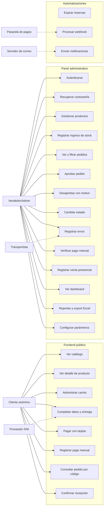

# 02 — Actores y Casos de Uso

**Proyecto:** NANAI Miel Orgánica
**Versión:** 1.0 (Fase 1 — Especificación)
**Estado:** En revisión

---

## 1. Actores

### 1.1 Cliente anónimo (actor principal)

| Aspecto | Detalle |
|---|---|
| **Descripción** | Persona que visita el sitio, conoce el catálogo y compra sin necesidad de crear una cuenta. |
| **Habilidades** | Navegador web o móvil, acceso a internet, una forma de pago (tarjeta, Yape/Plin o transferencia). |
| **Frecuencia** | Baja en el inicio (compradores ocasionales de miel orgánica), con potencial de recompra. |
| **Objetivo** | Encontrar el producto adecuado, comprarlo con confianza y **saber en qué estado está su pedido sin llamar ni registrarse**. |
| **Punto de pain** | La incertidumbre después de pagar. La respuesta a "ya-envio" es un código de pedido, no un correo. |
| **Identificación en el sistema** | Ninguna. Se identifica por el **código de pedido** (`NAN-AAAA-NNNNNN`) y por los datos declarados en la compra (nombre, DNI, teléfono, correo). |
| **Datos que deja** | Dirección, teléfono, correo y (opcionalmente) DNI. Tratados conforme a la Ley N.º 29733. |
| **Capacidades en el sistema** | Consultar catálogo, administrar su carrito, crear pedidos, pagar, rastrear su pedido, confirmar recepción. |
| **Lo que NO puede hacer** | Acceder al panel, ver pedidos ajenos, modificar un pedido ya confirmado, ver reportes. |

> **Por qué no hay "Cliente registrado" en la v1:** obligar a registrarse agrega fricción en el paso que más cuesta (el checkout) y el beneficio real —el historial de compras— puede obtenerse después con el correo. El esquema de datos contempla `cliente_id` nullable para que activarlo más adelante no exija migración.

### 1.2 Vendedor / Administrador (actor principal)

| Aspecto | Detalle |
|---|---|
| **Descripción** | Dueño del emprendimiento. Opera el día a día del negocio desde el panel. |
| **Habilidades** | Competencia digital básica. Usa un celular o una computadora con navegador. |
| **Frecuencia** | Diaria. |
| **Objetivo** | Vender sin esfuerzo manual: que el stock no se desincronice, que los pedidos no se pierdan, que las ventas presenciales se registren y que sepa qué necesita su atención hoy. |
| **Punto de pain** | El trabajo manual: llevar el stock en un cuaderno, perseguir pagos por Yape, adivinar qué pedidos están listos para enviar. |
| **Identificación en el sistema** | Usuario con sesión iniciada. En la v1 existe **un** usuario; el modelo ya soporta varios con roles. |
| **Capacidades** | Todas las del panel administrativo. |
| **Lo que NO puede hacer** | Emitir comprobantes electrónicos ante SUNAT (fuera de alcance), modificar el catálogo de estados del pedido desde la interfaz (se gobierna por datos, pero el alta inicial es del desarrollador). |

### 1.3 Pasarela de pagos (actor externo del sistema)

| Aspecto | Detalle |
|---|---|
| **Descripción** | Proveedor externo que procesa el pago con tarjeta y notifica el resultado. |
| **Interacción** | El sistema le **envía** una intención de pago y **recibe** un webhook firmado. |
| **Confianza** | Parcial. Se **verifica** el estado real del pago consultando a la pasarela antes de confirmar la venta; no se confía ciegamente en el webhook. |
| **Datos que ve** | El mínimo: importe, moneda, referencia del pedido, y los datos del titular que el proveedor exija. **Nunca** se le transfiere información de otros clientes. |
| **Datos que nunca almacena el sistema** | Número de tarjeta, CVV, fecha de vencimiento. Esos datos nunca salen del navegador hacia nuestro servidor. |

### 1.4 Proveedor de consulta de DNI (actor externo del sistema)

| Aspecto | Detalle |
|---|---|
| **Descripción** | Intermediario con acceso a datos de RENIEC. RENIEC no publica una API abierta, por lo que se usa un intermediario. |
| **Interacción** | El backend consulta por número de DNI y recibe nombres y apellidos. |
| **Confianza** | Media. Se valida el formato del DNI localmente y se trata la respuesta como **sugerencia de autocompletado**, no como dato verificado por el sistema |
| **Límite** | Solo se consulta desde el backend. La credencial del proveedor **nunca** viaja al navegador. |

### 1.5 Servidor de correo (actor externo del sistema)

| Aspecto | Detalle |
|---|---|
| **Descripción** | Servicio SMTP/transaccional que entrega las notificaciones. |
| **Interacción** | Un servicio central de correo pide "envía este correo" y el servicio decide con qué proveedor lo hace. |
| **Cambiabilidad** | Reemplazable por configuración, sin tocar código de negocio. |

### 1.6 Transportista (actor externo del sistema)

| Aspecto | Detalle |
|---|---|
| **Descripción** | Empresa de transporte (Shalom inicialmente, otras después) que entrega el pedido. |
| **Interacción** | Hoy es solo **declarativa**: el vendedor registra agencia, código de seguimiento, fecha y enlace. No hay integración por API. |
| **Cambiabilidad** | Catálogo administrable de agencias. El sistema no depende de una sola empresa. |

### 1.7 Actor interno: Sistema (automatizaciones)

Procesos que se ejecutan sin intervención humana:

| Automatización | Disparo |
|---|---|
| Expiración de reservas | Tarea programada (cron) cada N minutos |
| Aplicación de webhook de pago | Solicitud HTTP entrante del proveedor |
| Envío de notificaciones | Evento de negocio (pedido creado, aprobado, enviado…) |
| Cálculo de stock disponible | Derived en tiempo de consulta, no columna almacenada |

---

## 2. Mapa actor ↔ casos de uso

---

## 3. Matriz de permisos

`✔` permitido · `—` no aplica · `✖` explícitamente denegado

| Capacidad | Cliente anónimo | Vendedor | Pasarela | Sistema |
|---|:---:|:---:|:---:|:---:|
| Ver catálogo y detalle de producto | ✔ | ✔ | — | — |
| Administrar su propio carrito | ✔ | ✔ | — | — |
| Crear un pedido | ✔ | ✔ | — | — |
| Iniciar un pago | ✔ | ✔ | — | — |
| Confirmar un pago con webhook | ✖ | — | ✔ | — |
| Verificar un pago manual (Yape/Plin) | ✖ | ✔ | — | — |
| Consultar **un** pedido por código | ✔ | ✔ | — | — |
| Listar todos los pedidos | ✖ | ✔ | — | — |
| Ver datos personales de un cliente | ✖ | ✔ | ✖ | — |
| Aprobar / desaprobar pedidos | ✖ | ✔ | — | — |
| Registrar venta presencial | ✖ | ✔ | — | — |
| Registrar ingreso de stock | ✖ | ✔ | — | — |
| Crear / editar productos | ✖ | ✔ | — | — |
| Configurar parámetros del negocio | ✖ | ✔ | — | — |
| Expirar reservas | ✖ | — | — | ✔ |

> **Protección estructural:** el panel se sirve bajo un prefijo distinto (`/admin`) y **todas** sus rutas pasan por el middleware de autenticación. La API pública y la del panel son routers separados, montados por separado: un error de montaje en uno no expone al otro.

---

## 4. Casos de uso

### 4.1 Formato

Los casos de uso **críticos** (los que tocan dinero o stock) se documentan con el
formato completo. Los **de soporte** (CRUD administrativos) se resumen en la tabla
de §4.3, porque un CRUD no tiene flujos alternativos relevantes y documentarlos
extensamente solo genera ruido.

---

### 4.2 Casos de uso críticos

#### CU-01 — Consultar el catálogo de productos

| Campo | Contenido |
|---|---|
| **Actor** | Cliente anónimo |
| **Precondiciones** | El cliente está en el sitio público |
| **Requisito** | RF-002, RF-001 |
| **Disparador** | El cliente navega al catálogo |
| **Flujo principal** | 1. El cliente abre el catálogo. 2. El sistema devuelve la lista paginada de productos disponibles con: imagen de portada, nombre, precio (con IGV incluido), peso/presentación y disponibilidad. 3. El cliente puede filtrar por categoría y ordenar. 4. El cliente selecciona un producto → CU-02 |
| **Postcondiciones** | Ninguna escritura en la base de datos |
| **Flujos alternativos** | **FA-1:** no hay productos → se muestra un mensaje y se sugiere contacto por redes sociales. **FA-2:** el producto está agotado → se muestra, pero sin opción de compra y con etiqueta "Agotado" |
| **Reglas aplicadas** | RF-002, RF-001, RN-14 |

#### CU-04 — Administrar el carrito de compras

| Campo | Contenido |
|---|---|
| **Actor** | Cliente anónimo |
| **Precondiciones** | El cliente ha abierto al menos un producto del catálogo |
| **Requisito** | RF-006 … RF-011 |
| **Disparador** | El cliente pulsa "Agregar al carrito" o "Comprar" |
| **Flujo principal** | 1. El cliente agrega un producto con una cantidad. 2. El sistema **verifica contra la base de datos** que la cantidad esté disponible y que el producto esté activo y con precio vigente. 3. El carrito se guarda en el navegador. 4. El cliente puede modificar cantidades, eliminar ítems o vaciar el carrito. 5. El cliente procede al checkout → CU-05 |
| **Postcondiciones** | El carrito persiste en `localStorage`; **no** hay ninguna escritura en la base de datos |
| **Flujos alternativos** | **FA-1:** la cantidad supera el stock disponible → se avisa y se limita al máximo disponible. **FA-2:** el producto fue desactivado o su precio cambió → se informa y se permite actualizar el carrito. **FA-3:** el carrito quedó vacío → se muestra el estado vacío con enlace al catálogo |
| **Reglas aplicadas** | RN-01 (el carrito no reserva ni descuenta stock), RF-009 (los totales se calculan en el servidor) |
| **Nota de diseño** | El cliente **nunca** envía precios. Cuando el servidor calcula el total, toma el precio vigente de la base de datos. Esto evita que alguien manipule el carrito con las herramientas del navegador. |

#### CU-05 — Completar los datos del cliente y la modalidad de entrega

| Campo | Contenido |
|---|---|
| **Actor** | Cliente anónimo |
| **Precondiciones** | El carrito tiene al menos un producto |
| **Requisito** | RF-012, RF-013, RF-014, RF-015 |
| **Disparador** | El cliente pulsa "Continuar con la compra" |
| **Flujo principal** | 1. El sistema solicita nombre, teléfono, correo y, si la modalidad es entrega local, la dirección de destino. 2. El cliente indica su DNI (opcional) y el sistema **valida el formato localmente**. 3. Si el cliente lo desea, el sistema consulta al proveedor de DNI **desde el backend** y autocompleta los nombres. 4. El cliente elige la modalidad: `ENTREGA_LOCAL` o `ENVIO_AGENCIA`. 5. El sistema calcula el costo de envío según la zona, la modalidad y los umbrales de gratuidad configurados. 6. El sistema muestra el resumen con el total final y el IGV incluido. |
| **Postcondiciones** | Ninguna escritura en la base de datos |
| **Flujos alternativos** | **FA-1:** el proveedor de DNI no responde o agota créditos → el checkout **continúa funcionando** sin autocompletar; se avisa que el dato se ingressará a mano. **FA-2:** el DNI no cumple el formato (8 dígitos) → error de validación en línea. **FA-3:** la dirección queda fuera de la zona de entrega local → el sistema ofrece envío por agencia. |
| **Reglas aplicadas** | RF-013 (la API externa se consulta desde el backend), RNF-012 (minimización de datos) |
| **Decisión de diseño** | La consulta de DNI es **opcional y tolerante a fallos**. Un proveedor caído no puede impedir una venta. |

#### CU-06 — Crear el pedido

| Campo | Contenido |
|---|---|
| **Actor** | Cliente anónimo |
| **Precondiciones** | El carrito es válido, hay stock disponible y los datos del cliente están completos |
| **Requisito** | RF-016, RF-017 |
| **Disparador** | El cliente confirma el pedido |
| **Flujo principal** | 1. El backend **recalcula** los precios y el total desde la base de datos. 2. El backend abre una **transacción**. 3. Se genera el código único del pedido (`NAN-AAAA-NNNNNN`). 4. Se **reserva** el stock de cada producto y se registra el movimiento de inventario de tipo `RESERVA`. 5. Se insertan el pedido y sus líneas con el **snapshot** de precios. 6. Se registra el estado inicial del pedido en el historial. 7. Se confirma la transacción. 8. El sistema devuelve el código del pedido y la URL de seguimiento. 9. Se dispara la notificación "pedido registrado". |
| **Postcondiciones** | El pedido existe en estado `PENDIENTE_PAGO`, con reserva de stock vigente y con historial de un solo evento |
| **Flujos alternativos** | **FA-1:** no hay stock suficiente en el momento de crear el pedido → la transacción se revierte (`ROLLBACK`) y se devuelve un error 409 con el detalle de los productos sin stock. **FA-2:** el cliente reintenta la misma operación → se detecta por la **clave de idempotencia** y se devuelve el pedido ya creado, sin duplicar reservas. **FA-3:** la transacción falla por cualquier motivo → `ROLLBACK` completo. No queda stock reservado ni pedido a medias. |
| **Reglas aplicadas** | RN-02, RN-05, RN-09, RNF-018, RNF-019, RNF-023 |
| **Atomicidad** | Los pasos 3–6 ocurren dentro de **una sola** transacción. O se crea el pedido con su reserva, o no se crea nada. |

#### CU-07 — Pagar con tarjeta

| Campo | Contenido |
|---|---|
| **Actor** | Cliente anónimo, con intervención de la Pasarela de pagos |
| **Precondiciones** | El pedido está en `PENDIENTE_PAGO` y su reserva sigue vigente |
| **Requisito** | RF-019, RF-021, RF-022 |
| **Disparador** | El cliente elige pagar con tarjeta |
| **Flujo principal** | 1. El backend genera una **intención de pago** en la pasarela, asociando el pedido y su importe. 2. El navegador muestra el formulario seguro del proveedor. 3. **Los datos de la tarjeta viajan directamente del navegador a la pasarela.** Nunca pasan por nuestro servidor. 4. La pasarela confirma y envía un webhook firmado a nuestro sistema. 5. El backend valida la firma, verifica el estado real del pago consultando a la pasarela y, si coincide, transiciona el pedido a `PAGADO`. 6. Se registra el pago y se notifica al cliente y al vendedor. |
| **Postcondiciones** | El pedido está en `PAGADO`; el pago está registrado; el stock sigue **reservado** (aún no descontado) |
| **Flujos alternativos** | **FA-1:** el cliente cierra el formulario → el pedido sigue en `PENDIENTE_PAGO`; la reserva vence sola a los 30 minutos. **FA-2:** la pasarela rechaza el pago → se registra el intento fallido y el cliente puede reintentar. **FA-3:** llega un webhook con firma inválida → se rechaza y se registra el intento. **No se cambia el estado del pedido.** **FA-4:** llega el mismo webhook dos veces → la idempotencia lo detecta: el pago se aplica una sola vez. **FA-5:** el webhook dice "aprobado" pero la consulta directa a la pasarela dice "pendiente" → **no se transiciona**. Se registra la inconsistencia para revisión. |
| **Reglas aplicadas** | RN-11 (idempotencia), RNF-002, RNF-006, RNF-010 |
| **Decisión de seguridad** | El paso 5 **vuelve a preguntar a la pasarela**. El webhook es una *notificación*, no una *prueba*. Un webhook firmado sigue siendo un dato que llega por la red. |

#### CU-08 — Registrar un pago por Yape, Plin o transferencia

| Campo | Contenido |
|---|---|
| **Actor** | Cliente anónimo → luego Vendedor |
| **Precondiciones** | El pedido está en `PENDIENTE_PAGO` |
| **Requisito** | RF-020, RF-024 |
| **Flujo principal** | 1. El cliente elige el medio de pago manual y ve los datos de la cuenta de NANAI (número, alias, banco). 2. El sistema genera un **código de referencia** corto derivado del código del pedido. 3. El cliente realiza la transferencia fuera del sistema. 4. El cliente registra en el sistema que realizó el pago (opcional, acelera la verificación). 5. El pedido queda en `PAGO_POR_VERIFICAR`. 6. El vendedor ve el pago pendiente y ejecuta CU-26. |
| **Postcondiciones** | El pedido tiene un pago registrado en estado `POR_VERIFICAR`; el stock sigue reservado |
| **Flujos alternativos** | **FA-1:** el cliente no registra nada → el vendedor puede verificarlo manualmente de todos modos, porque ve el pedido y el código de referencia. **FA-2:** el vendedor verifica que el pago no llegó → el pago se marca como rechazado y el pedido vuelve a `PENDIENTE_PAGO` para que el cliente pueda intentar con otro medio. **FA-3:** la reserva caduca antes de verificarse → el pedido se cancela; si el vendedor detecta el pago después, debe iniciar un proceso de devolución manual, que queda registrado. |
| **Reglas aplicadas** | RN-04, RN-11 |
| **Decisión de negocio** | El motivo del rechazo del pago **no** cancela el pedido automáticamente: se devuelve a `PENDIENTE_PAGO` para que el cliente reintente mientras la reserva siga viva. |

#### CU-09 — Consultar un pedido por su código

| Campo | Contenido |
|---|---|
| **Actor** | Cliente anónimo |
| **Precondiciones** | El cliente tiene el código del pedido |
| **Requisito** | RF-026, RF-027, RF-028, RF-029, RF-031 |
| **Disparador** | El cliente ingresa el código en la sección "Rastrear mi pedido" |
| **Flujo principal** | 1. El cliente escribe el código (con o sin guion). 2. El backend lo normaliza a mayúsculas y busca el pedido. 3. El sistema devuelve: estado actual, historial de estados, líneas del pedido con cantidades y precios, total, **estado del pago**, modalidad de entrega y, si existe, agencia, código de seguimiento, fecha de envío y enlace. |
| **Postcondiciones** | Ninguna escritura |
| **Flujos alternativos** | **FA-1:** el código no existe → mensaje "no encontramos pedidos con ese código". **La respuesta no revela si existió** información sensible ni distingue entre "código inexistente" y "pedido de otro cliente". **FA-2:** el pedido está cancelado → se muestra igualmente, con su motivo, para que el cliente entienda qué pasó. |
| **Reglas aplicadas** | RN-10, RNF-010 |
| **Riesgo de seguridad y mitigación** | El código es la única credencial. Mitigaciones: (a) el código tiene 6 dígitos secuenciales por año, lo que reduce el espacio de búsqueda, pero no lo elimina; (b) se aplica **rate limiting** al endpoint; (c) el código **no** expone datos de contacto completos del cliente (teléfono y correo se ocultan parcialmente); (d) no se permite enumerar pedidos por otros medios. |

#### CU-10 — Confirmar la recepción del pedido

| Campo | Contenido |
|---|---|
| **Actor** | Cliente anónimo |
| **Precondiciones** | El pedido está en `EN_TRANSITO` o `RECIBIDO` |
| **Requisito** | RF-030 |
| **Disparador** | El cliente pulsa "Confirmar que recibí mi pedido" |
| **Flujo principal** | 1. El cliente confirma la recepción. 2. El sistema transiciona el pedido a `RECIBIDO` (o a `COMPLETADO`, si esa es la transición por defecto desde el estado actual). 3. Se registra el evento en el historial y se notifica al vendedor. |
| **Postcondiciones** | El pedido refleja la recepción y el vendedor recibe el aviso |
| **Flujos alternativos** | **FA-1:** el pedido no está en un estado que permita la transición → mensaje explicativo ("tu pedido aún está en preparación"). |
| **Reglas aplicadas** | RN-06, RN-07, RN-08 |

---

#### CU-11 — Autenticarse en el panel

| Campo | Contenido |
|---|---|
| **Actor** | Vendedor |
| **Requisito** | RF-032, RF-035, RF-036 |
| **Flujo principal** | 1. El vendedor envía correo y contraseña. 2. El backend busca el usuario y verifica la contraseña con **Argon2id**. 3. Si son correctos, se crea una sesión en el servidor y se envía una cookie `httpOnly` + `SameSite=Lax`. 4. El panel carga. |
| **Postcondiciones** | Sesión activa; la cookie no es accesible desde JavaScript |
| **Flujos alternativos** | **FA-1:** credenciales incorrectas → error genérico ("correo o contraseña incorrectos"). **No se revela cuál de los dos falló**. **FA-2:** demasiados intentos → bloqueo temporal con rate limiting y aviso. **FA-3:** cuenta desactivada → se rechaza con un mensaje que no expone el estado de la cuenta más allá de lo necesario. |
| **Reglas aplicadas** | RNF-001, RNF-004, RNF-006 |

#### CU-12 — Recuperar la contraseña

| Campo | Contenido |
|---|---|
| **Actor** | Vendedor |
| **Requisito** | RF-034, RF-036, RF-067 |
| **Flujo principal** | 1. El vendedor indica su correo. 2. El backend genera un **código temporal aleatorio** y guarda **solo su hash**, junto con su fecha de expiración. 3. Se envía el código al correo registrado. 4. El vendedor introduce el código y la nueva contraseña. 5. El backend verifica el hash, la expiración y que no haya sido usado. 6. Se guarda la nueva contraseña con Argon2id y el código se marca como usado. |
| **Postcondiciones** | Contraseña nueva almacenada con hash; el código queda invalidado; las sesiones existentes se revocan |
| **Flujos alternativos** | **FA-1:** el correo no está registrado → la API responde **idénticamente** que en el caso exitoso, para no revelar qué correos existen. **FA-2:** el código expiró → se pide uno nuevo. **FA-3:** el código ya se usó → se rechaza. **FA-4:** se superan los límites de solicitudes → se bloquea temporalmente y se avisa por correo. |
| **Reglas aplicadas** | RNF-001, RNF-006, RF-067 |
| **Decisión de seguridad** | El correo **nunca** contiene la contraseña. Contiene un código de un solo uso y de corta duración. Y el correo de respuesta es idéntico exista o no la cuenta: el endpoint no puede usarse para enumerar usuarios. |

#### CU-22 — Aprobar un pedido

| Campo | Contenido |
|---|---|
| **Actor** | Vendedor |
| **Prequisito** | RF-046 |
| **Precondiciones** | El pedido está en `PENDIENTE_APROBACION` y su pago está `APROBADO` o `POR_VERIFICAR` |
| **Flujo principal** | 1. El vendedor pulsa "Aprobar". 2. El backend verifica que la transición es válida. 3. En una **transacción**: se cambia el estado, se registra el historial y, **si el estado destino consume stock**, se descuenta el stock definitivo y se registra el movimiento de inventario. 4. Se notifica al cliente. |
| **Postcondiciones** | Estado actualizado, historial con actor y fecha, stock ajustado según la regla, cliente notificado |
| **Flujos alternativos** | **FA-1:** la transición no es válida desde el estado actual → error 409 con la lista de transiciones permitidas. **FA-2:** el pago no está confirmado → se impide aprobar y se indica que el pago debe verificarse primero. |
| **Reglas aplicadas** | RN-03, RN-05, RN-06, RN-07, RNF-018 |

#### CU-23 — Desaprobar un pedido con motivo

| Campo | Contenido |
|---|---|
| **Actor** | Vendedor |
| **Requisito** | RF-047, RF-031 |
| **Precondiciones** | El pedido no está en un estado final |
| **Flujo principal** | 1. El vendedor pulsa "Desaprobar" y escribe el motivo (**obligatorio**). 2. En una **transacción**: se cambia el estado, se registra el historial con el motivo, y **si el estado destino libera stock**, las unidades vuelven al stock disponible con su movimiento correspondiente. 3. Se notifica al cliente con el motivo. |
| **Postcondiciones** | El pedido figura como desaprobado con motivo visible para el cliente; el stock se liberó |
| **Flujos alternativos** | **FA-1:** se intenta desaprobar sin motivo → el formulario no se envía; el backend también lo rechaza. |
| **Reglas aplicadas** | RN-04, RN-06, RN-13 |

#### CU-26 — Verificar un pago manual (Yape, Plin, transferencia)

| Campo | Contenido |
|---|---|
| **Actor** | Vendedor |
| **Requisito** | RF-024, RF-020 |
| **Flujo principal** | 1. El vendedor abre el pedido y revisa el pago pendiente. 2. Tras confirmar en su cuenta bancaria o de Yape/Plin, pulsa "Confirmar pago". 3. Se registra el pago como `APROBADO` con la referencia y la fecha de verificación. 4. Se transiciona el pedido según la máquina de estados. 5. Se notifica al cliente. |
| **Postcondiciones** | El pago queda aprobado y auditado con el usuario que lo verificó |
| **Flujos alternativos** | **FA-1:** el vendedor no encuentra el pago → "Rechazar pago", que devuelve el pedido a `PENDIENTE_PAGO` (no lo cancela). |
| **Reglas aplicadas** | RN-11, RN-06 |
| **Auditoría** | El movimiento registra **qué usuario** verificó el pago. En una Auditoría de SUNAT o una disputa con el cliente, esa trazabilidad vale dinero. |

#### CU-27 — Registrar una venta presencial

| Campo | Contenido |
|---|---|
| **Actor** | Vendedor |
| **Requisito** | RF-056, RF-057, RF-055 |
| **Flujo principal** | 1. El vendedor abre "Nueva venta presencial". 2. Busca y agrega productos con sus cantidades. 3. El sistema muestra los totales calculados en el servidor. 4. El vendedor elige el medio de pago (efectivo, tarjeta, Yape/Plin, transferencia). 5. Confirma la venta. 6. En una **transacción**: se crea la venta con `tipo_venta = PRESENCIAL`, sus líneas, se **descuenta el stock definitivo**, se registran los movimientos de inventario y se genera la boleta. 7. El sistema muestra la boleta lista para imprimir. |
| **Postcondiciones** | Venta registrada, stock actualizado, movimientos generados, boleta disponible |
| **Flujos alternativos** | **FA-1:** no hay stock suficiente → se impide continuar indicando el faltante. **FA-2:** el cliente no quiere dejar datos → se permite registrar la venta **sin cliente**, con datos opcionales. |
| **Reglas aplicadas** | RN-12, RN-05, RN-15, RNF-018 |
| **Decisión de diseño** | La venta presencial **no pasa por la máquina de estados**: es una operación de caja, completa e inmediata. Comparte el motor de totales, el inventario y la tabla de líneas con la venta online, pero no necesita un ciclo de aprobación. Esto evita un modelo retorcido donde una venta de mostrador esperaría "aprobación". |

#### CU-34 — Expirar las reservas de stock

| Campo | Contenido |
|---|---|
| **Actor** | Sistema (tarea programada) |
| **Requisito** | RF-018, RN-02 |
| **Flujo principal** | 1. La tarea se ejecuta cada N minutos. 2. Busca pedidos en `PENDIENTE_PAGO` cuya reserva venció. 3. Por cada uno, en una transacción: cambia el estado a `CANCELADO` con motivo "reserva expirada", libera el stock, registra el movimiento de inventario y anota el historial. 4. Notifica al cliente si corresponde. |
| **Postcondiciones** | Ningún pedido queda con reserva vencida |
| **Flujos alternativos** | **FA-1:** el pago se confirmó justo antes de la expiración → la tarea verifica el estado real del pago antes de cancelar; si el pago está aprobado, **no cancela**. **FA-2:** dos instancias de la tarea corren a la vez → el bloqueo de la fila (`SELECT ... FOR UPDATE`) garantiza que solo una procese cada pedido. |
| **Reglas aplicadas** | RN-02, RN-04, RN-05, RNF-018 |
| **Nota crítica** | Esta tarea es la que evita el "stock fantasma": sin ella, un cliente que abandona el checkout dejaría la mercancía bloqueada para siempre. Es **la** tarea que másaruinos caro si falla, y por eso tiene su propia prueba automática. |

---

### 4.3 Casos de uso de soporte (resumen)

| ID | Caso de uso | Actor | RF | Notas de diseño |
|---|---|---|---|---|
| CU-02 | Consultar el detalle de un producto | Cliente | RF-003 | Devuelve producto, imágenes, características, beneficios y consumo |
| CU-03 | Ver el contenido institucional | Cliente | RF-004 | Contenido editable, no hardcodeado en el HTML |
| CU-13 | Gestionar productos | Vendedor | RF-038 | CRUD; el stock inicial genera movimiento de ingreso |
| CU-14 | Gestionar categorías | Vendedor | RF-039 | No se elimina una categoría con productos: se desactiva |
| CU-15 | Adjuntar imágenes de un producto | Vendedor | RF-040 | Capa de almacenamiento intercambiable: disco local hoy, bucket mañana |
| CU-16 | Editar características, beneficios y consumo | Vendedor | RF-041 | Listas dinámicas; advertencia de salud (RF-043) |
| CU-17 | Registrar un ingreso de stock | Vendedor | RF-051 | Ej.: ingresan 50 unidades → stock +50 y movimiento `INGRESO` |
| CU-18 | Registrar ajuste o merma | Vendedor | RF-052 | Exige justificación; genera movimiento con motivo |
| CU-19 | Consultar movimientos de inventario | Vendedor | RF-053 | Filtros por producto, tipo, fecha y origen |
| CU-20 | Ver y filtrar pedidos | Vendedor | RF-044 | Filtros por estado, fecha, tipo de venta y entrega |
| CU-21 | Ver el detalle de un pedido | Vendedor | RF-045 | Consolida cliente, líneas, pagos, historial y envío |
| CU-24 | Cambiar el estado de un pedido | Vendedor | RF-048 | Solo transiciones válidas; exige motivo si el estado lo pide |
| CU-25 | Registrar los datos de envío | Vendedor | RF-049 | Agencia, código, fecha y enlace opcional |
| CU-28 | Emitir y ver la boleta | Vendedor | RF-057 | Comprobante **interno**; no es comprobante electrónico SUNAT |
| CU-29 | Ver el dashboard | Vendedor | RF-059 | Número acotado de consultas agregadas, no una por indicador |
| CU-30 | Generar y exportar reportes | Vendedor | RF-060, RF-061 | Exportación a Excel desacoplada de los controladores |
| CU-31 | Configurar parámetros del negocio | Vendedor | RF-062 | IGV, TTL de reserva, costos de envío, umbral de stock |
| CU-32 | Gestionar usuarios y roles | Vendedor | RF-037 | Esquema preparado desde el inicio; interfaz mínima en la v1 |
| CU-33 | Gestionar agencias de transporte | Vendedor | RF-050 | Catálogo administrable; sin dependencia de un solo transportista |
| CU-35 | Procesar el webhook de la pasarela | Pasarela | RF-021, RF-023 | Valida firma, verifica el estado real e ignora duplicados |
| CU-36 | Enviar notificaciones por correo | Sistema | RF-064, RF-065, RF-066 | Servicio central; el proveedor es intercambiable |
| CU-37 | Consultar el DNI del cliente | Sistema | RF-013 | Auxiliar de CU-05; tolerante a fallos |
| CU-38 | Verificar disponibilidad de stock | Sistema | RF-007 | Se calcula sobre stock físico menos reservas vigentes |

---

## 5. Reglas de negocio derivadas de los casos de uso

| Regla | Origen |
|---|---|
| El fallo del proveedor de DNI no puede bloquear la venta | CU-05 / FA-1 |
| El fallo del servidor de correo no puede hacer fallar un pedido | CU-06, CU-36 |
| Un webhook no es una prueba: se contrasta con la pasarela | CU-07 / FA-5 |
| La respuesta de recuperación de contraseña no revela si el correo existe | CU-12 / FA-1 |
| La respuesta de consulta de pedido no revela datos de otros clientes | CU-09 / FA-1 |
| Aprobar un pedido sin pago confirmado se impide | CU-22 / FA-2 |
| Desaprobar exige motivo | CU-23 / FA-1 |
| La venta presencial no requiere datos de cliente | CU-27 / FA-2 |
| La reserva expirada libera el stock y cancela el pedido | CU-34 |
| El pago confirmado a tiempo sobrevive a la expiración de la reserva | CU-34 / FA-1 |

---

## 6. Trazabilidad casos de uso ↔ requisitos

| Caso de uso | Requisitos | Estados de pedido involucrados |
|---|---|---|
| CU-04 | RF-006 … RF-011 | — |
| CU-06 | RF-016, RF-017 | `PENDIENTE_PAGO` |
| CU-07 | RF-019, RF-021, RF-022 | `PENDIENTE_PAGO` → `PAGADO` |
| CU-09 | RF-026 … RF-029, RF-031 | todos (consulta) |
| CU-22 | RF-046 | `PENDIENTE_APROBACION` → `APROBADO` |
| CU-23 | RF-047 | `*` → `DESAPROBADO` |
| CU-27 | RF-056, RF-057 | venta directa (sin máquina de estados) |
| CU-34 | RF-018 | `PENDIENTE_PAGO` → `CANCELADO` |

---

> **Siguiente paso:** `03-reglas-de-negocio.md`, donde la máquina de estados queda
> definida con sus transiciones, sus efectos y sus permisos, y donde se fija la
> tabla que gobierna el stock.
