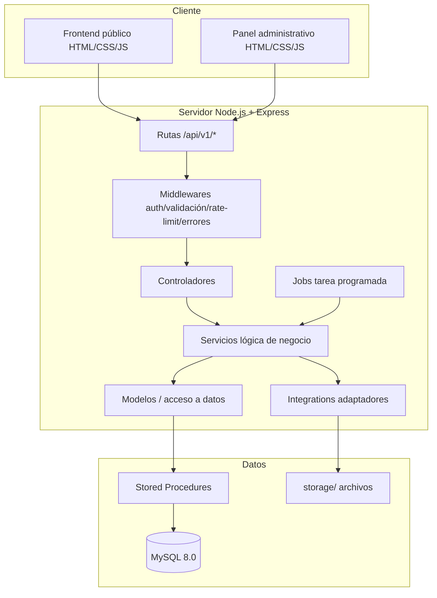
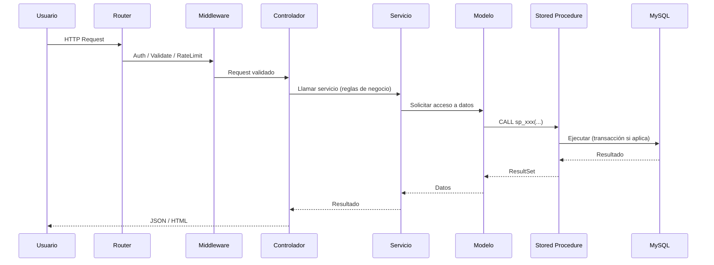

# 04 — Arquitectura

**Proyecto:** NANAI Miel Orgánica  
**Versión:** 1.0 (Fase 1 — Especificación)  
**Estado:** En revisión  
**Principios:** Separación de responsabilidades, bajo acoplamiento, alta cohesión, modularidad, código mantenible, seguridad desde el diseño

---

## 1. Objetivo

Definir la arquitectura que permita crecer sin reescribir grandes partes. Todo lo que entra por HTTP debe fluir por las mismas capas. La lógica de negocio **nunca** vive en rutas ni en controladores.

---

## 2. Visión arquitectónica

El sistema sigue un **monolito modular** con patrón **MVC por capas**. No hay microservicios en la v1: es más simple de depurar, desplegar y aprender. Los módulos están aislados para poder extraerlos después si fuera necesario.



---

## 3. Capas y responsabilidades

| Capa | Carpeta | Responsabilidad | Restricciones |
|---|---|---|---|
| **Rutas** | `src/routes/` | Mapear URL + método HTTP al controlador. Montar middlewares. | Sin lógica. Solo `router.use()` / `router.get/post`. |
| **Middlewares** | `src/middleware/` | Auth, autorización por rol, validación, rate limiting, manejo de errores, 404. | Reutilizables. Sin lógica de negocio. |
| **Controladores** | `src/controllers/` | Traducir HTTP (`req`/`res`). Leer datos, llamar al **servicio**, formatear respuesta. | **Sin** `SQL`. **Sin** reglas de negocio. Solo orquestación HTTP. |
| **Servicios** | `src/services/` | **Lógica de negocio**: transacciones, máquina de estados, stock, reservas, pagos. | Aquí viven las reglas de `03-reglas-de-negocio.md`. Pueden llamar a otros servicios. |
| **Modelos / Data Access** | `src/models/` | Acceso a datos. Invocan **Stored Procedures** o queries parametrizadas. | **Sin** lógica de negocio. Devuelven datos puros o resultados de SP. |
| **Validadores** | `src/validators/` | Esquemas **Zod** para validar entrada. | Validación estructural, no reglas de negocio complejas. |
| **Integraciones** | `src/integrations/` | **Adaptadores** para proveedores externos (pasarela, DNI, correo, almacenamiento). | Contrato estable. Cambiar proveedor = cambiar implementador. |
| **Utilidades** | `src/utils/` | Funciones puras (formateo, código de pedido, helpers). | Sin side effects ni acceso a BD. |
| **Jobs** | `src/jobs/` | Tareas programadas (expirar reservas). | Llaman a servicios, nunca a controladores. |
| **Configuración** | `src/config/` | Variables de entorno validadas, pool MySQL, logger, constantes. | Centralizado. Único punto que lee `.env`. |

**Regla de dependencias:** Las flechas solo van **hacia adentro**. Un controlador no llama a otro controlador. Un modelo no llama a un servicio. Las integraciones no dependen de controladores.

---

## 4. Estructura de carpetas

```text
miel nanai/
├── .env
├── .env.example
├── .gitignore
├── .gitattributes
├── package.json
├── README.md
├── docs/                    # Documentación y ADRs
├── db/
│   ├── schema.sql           # Esquema completo
│   ├── seed.sql             # Datos iniciales (estados, categorías base)
│   ├── procedures/          # Stored Procedures (.sql)
│   └── migrations/          # Migraciones por fecha
├── src/
│   ├── app.js               # Configura Express (middlewares, rutas). NO escucha
│   ├── server.js            # Valida env, conecta BD, escucha, shutdown limpio
│   ├── config/
│   │   ├── env.js           # Validación con Zod
│   │   ├── db.js            # Pool mysql2/promise
│   │   ├── logger.js        # pino
│   │   └── constants.js
│   ├── routes/
│   │   ├── index.js         # Monta routers
│   │   ├── public/          # Catálogo, carrito, pedidos, seguimiento
│   │   ├── auth/            # Login/recuperación
│   │   └── admin/           # Panel protegido
│   ├── controllers/
│   ├── services/
│   ├── models/
│   ├── middleware/
│   │   ├── auth.js          # Protección de rutas
│   │   ├── validate.js      # Wrapper con Zod
│   │   ├── errorHandler.js  # Manejador central
│   │   ├ rateLimiter.js
│   │   └── notFound.js
│   �tagirns
│   ├── validators/
│   ├── utils/
│   ├── integrations/
│   │   ├── payments/        # Adapter pasarela
│   │   ├── dni/             # Adapter consulta DNI
│   │   ├── mail/            # Adapter correo
│   │   �taginst storage/      # Adapter almacenamiento
│   ├── jobs/
│   │   └── expirar-reservas.js
│   └── views/               # No se usará en la v1; se opta for HTML estatico / JS modular
├── public/
│   ├── css/
│   ├── js/
│   ├── images/              # imágenes estáticas
│   ├# index.html
│   ├── admin/               # Panel administrativo
│   └── assets/
└── storage/                 # uploads dev (gitignored)
```

> **Nota:** El archivo `src/app.js` **no escucha** el puerto. Ese rol es exclusivo de `src/server.js`. Esto permite importar `app` para pruebas sin levantar servidor.

---

## 5. Flujo de una petición



**Reglas del flujo:**

1. **Rutas** solo enrutan.
2. **Middleware de validación** usa esquemas Zod. Si falla → `400` con detalles.
3. **Controlador** extrae lo necesario y delega al servicio.
4. **Servicio** aplica reglas, decide transacciones y orquestación.
5. **Modelo** invoca Stored Procedure o consulta parametrizada.
6. **Errores** pasan al `errorHandler` central.

---

## 6. Manejador central de errores

Se implementa un error personalizado `AppError` y un handler único.

```js
// src/utils/AppError.js
export class AppError extends Error {
  constructor(message, statusCode = 500, code = 'INTERNAL_ERROR', details = null) {
    super(message);
    this.statusCode = statusCode;
    this.code = code;
    this.isOperational = true;
    this.details = details;
  }
}
```

**Formato de respuesta (siempre):**

```json
{
  "success": false,
  "error": {
    "code": "STOCK_INSUFICIENTE",
    "message": "No hay stock suficiente para este producto.",
    "details": { "producto_id": 5, "solicitado": 10, "disponible": 3 }
  }
}
```

**Política:**

- En **producción**: nunca mostrar `stack`, rutas internas, consultas SQL ni credenciales.
- En **desarrollo**: mostrar stack trace para depurar.
- Errores operativos (`AppError`) se envían al cliente.
- Errores no operativos (inesperados) se registran con `pino` y se responde `500` genérico.
- `async/await` se envuelve con un wrapper `catchAsync` para evitar `try/catch` repetitivo.

---

## 7. Configuración y variables de entorno

Todo lo sensible va en `.env`. Se valida con **Zod** al arrancar (`src/config/env.js`).

### Variables previstas

| Variable | Tipo | Requisito | Notas |
|---|---|------|---}
| `NODE_ENV` | enum('development','production') | Obligatorio | Define exposición de errores |
| `PORT` | number | Obligatorio | Puerto del servidor |
| `APP_URL` | url | Obligatorio | URL base para enlaces de correo/panel |
| `DB_HOST` | string | Obligatorio | Host MySQL |
| `DB_PORT` | number | Obligatorio | Puerto MySQL (3306) |
| `DB_USER` | string | Obligatorio | Usuario **mínimo** (NO root) |
| `DB_PASSWORD` | string | Obligatorio | Contraseña del usuario app |
| `DB_NAME` | string | Obligatorio | `nanai_miel` |
| `SESSION_SECRET` | string (min 32) | Obligatorio | Secreto para sesiones |
| `SESSION_NAME` | string | Obligatorio | Nombre de cookie no descriptivo |
| `RESERVA_TTL_MINUTOS` | number (default 30) | Obligatorio | TTL de reserva |
| `BCRYPT_ARGON2_OPTIONS` | object/string | Opcional | Parámetros Argon2id |
| `PAGOS_PROVEEDOR` | enum | Opcional | `culqi` / `izipay` / `manual` / `test` |
| `PAGOS_API_KEY` | string | Opcional (luego) | Solo backend, nunca frontend |
| `PAGOS_WEBHOOK_SECRET` | string | Opcional (l)
    `PAGOS_VERIFICACION_CRUZADA` | boolean | Opcional (luego) | Verificar estado real |
| `DNI_PROVEEDOR` | string | Opcional | Adaptador de consulta DNI |
| `DNI_API_KEY` | string | Opcional | Solo backend |
| `MAIL_HOST/PORT/USER/PASS/FROM` | varios | Opcional | SMTP |
| `STORAGE_TYPE` | enum('local','cloud') | Opcional | local hoy, cloud mañana |
| `RATE_LIMIT_WINDOW_MS` | number | Opcional | Ventana de rate limit |
| `LOG_LEVEL` | enum('debug','info','warn','error') | Opciple (default `info`) | Logger pino |

`.env.example` **sí** se versiona. `.env** **no** se versiona.

---

## 8. Seguridad en la arquitectura

| Control | Aplicación |
|---|---|
| **Helmet** | Cabeceras HTTP secure. CSP restrictiva. |
| **CORS** | Restringido a `APP_URL`. Solo permitido: public y admin. |
| **Rate limiting** | Por IP: login, recuperación, crear pedido, webhook. Global más suave. |
| **CSRF** | Protección para operaciones POST/PUT/PATCH/DELETE en el panel. |
| **Cookie seguras** | `httpOnly`, `SameSite=Lax`, `Secure` en producción. `Domain` controlado. |
| **Sesiones** | `express-session` con store en MySQL. Expiración por inactividad + renovación opcional. |
| **Validación** | Zod en todos los campos. Backend **siempre** valida. |
| **SQL parametrizado** | Solo consultas parametrizadas. Stored Procedures con parámetros. |
| **PII minimizado** | En logs solo se enmascara. DNI/telefono/correo no aparecen completos. |
| **Error redaction** | Manejador central elimina datos sensibles. |
| **Privilegios mínimos** | Usuario MySQL `nanai_app` con `SELECT, INSERT, UPDATE, DELETE, EXECUTE`. **No** `DROP, CREATE, ALTER, GRANT`. |
| **Webhooks** | Firma verificada. `provider_event_id` único. Verificación cruzada. |
| **Desacoplamiento** | Integraciones con contrato. Crendenciales no en frontend. |

---

## 9. Patrones a seguir

| Patrón | Uso | Razón |
|---|---|---|
| **Repository/Data Access** | `src/models/` | Aísla SQL/SP del resto |
| **Service Layer** | `src/services/` | Encapsula lógica de negocio |
| **Adapter/Port** | `src/integrations/*/` | Cambiar proveedor sin reescribir negocio |
| **DTO/Contract** | `src/validators/` + respuestas formateadas | Contratos claros |
| **Error Handling](#6-manejador-central-de-errores) | `AppError` + `errorHandler` | Centralizado, consistente |
| **Dependency Injection (ligero)** | Config por módulo | Fácil de mockear en pruebas |
| **Transactional Script** | Servicios con `conn.beginTransaction()` | Suficiente para monolito modular |
| **Immutable Audit Trail] | `order_status_history`, `inventory_movements` | Trazabilidad sin borrados |
| **Idempotent Operations]` | Webhooks, crear pedido | Evitar duplicados |

---

##tag 10. ADRs previstos

| ADR | Título | Estado
|---|---|---|
| ADR-001 | Stack backend: Express 5 + ESM + @node-rs/argon2 + zod | Aprobado (ya registrado) |
| ADR-002 | Autenticación: sesiones en servidor + MySQL store | Aprobado (ya registrado) |
| ADR-003 | Precio con IGV 18% incluido | Aprobado (ya registrado) |
| ADR-004 | Medios de pago v1: Tarjeta + Yape/Plin/transferencia manual | Aprobado (ya registrado) |
| ADR-005 | Registro npm: npmmirror ahora + CA raíz después | Aprobado (ya registrado) |
| ADR-006 | Reserva temporal durante el proceso de pago, descuento definitivo al pasar to APROBADO | Pendiente a revisarse (listo) |
| ADR-007 & extentions | Adaptadores para integraciones externas / motor de precios extensible (descuentos/coupónnes) | Pendiente |
| ADR-008 | Stored Procedures as primary data access | Pending |

---

> **Siguiente paso:** `05-modelo-de-datos.md`, donde se define el esquema completo, índices justificados, relaciones, y los procedimientos almacenados previstos.
