# 05 — Modelo de Datos

**Proyecto:** NANAI Miel Orgánica  
**Versión:** 1.0 (Fase 1 — Especificación)  
**Estado:** En revisión  
**Motor:** MySQL 8.0, `utf8mb4_unicode_ci`  
**Motor de almacenamiento:** InnoDB  
**Importes:** `DECIMAL(10,2)` PEN (IGV 18% incluido)  
**Trazabilidad:** movimientos inmutables + historial de estados inmutable

---

## 1. Objetivo

Diseñar el esquema que soporte: catálogo dinámico, carrito no persistente, reserva temporal, máquina de estados por datos, inventario con dos libros, ventas online/presenciales, pagos, entregas, notificaciones y extensibilidad (roles, descuentos/cupones futuros).

---

## 2. Convenciones

| Convención | Regla |
|---|---|
| **Nombres** | `snake_case`. Tablas en plural (`products`, `orders`, `order_items`). |
| **PK** | `BIGINT UNSIGNED AUTO_INCREMENT` con nombre `id`. |
| **FK** | `*_id BIGINT UNSIGNED`. Índice implícito o explícito cuando sea necesario. |
| **Fechas** | `DATETIME` o `TIMESTAMP`. Usar `UTC` lógicamente; almacenar con `DEFAULT CURRENT_TIMESTAMP` / `ON UPDATE CURRENT_TIMESTAMP` según corresponda. |
| **Banderas** | `TINYINT(1)` para booleanos (`0/1`). |
| **Unicidad** | Claves `UNIQUE` donde aplique (códigos, correos, `provider_event_id`). |
| **Eliminación** | Preferir `activo`/`eliminado_logico` antes que `DELETE`. `DELETE` solo en casos muy justificados. |
| **Inmutables** | `order_status_history` e `inventory_movements` **sin UPDATE/DELETE**. |
| **Precios históricos** | Guardar `precio_unitario` en `order_items`. **Nunca** recalcular desde `products`. |

---

## 3. Diagrama Entidad-Relación (Mermaid)

```mermaid
erDiagram
  USERS ||--o{ ORDERS : crea
  USERS ||--o{ INVENTORY_MOVEMENTS : registra
  USERS ||--o{ ORDER_STATUS_HISTORY : ejecuta

  CATEGORIES ||--o{ PRODUCTS : agrupa
  PRODUCTS ||--o{ PRODUCT_IMAGES : tiene
  PRODUCTS ||--o{ PRODUCT_FEATURES : tiene
  PRODUCTS ||--o{ PRODUCT_BENEFITS : tiene
  PRODUCTS ||--o{ ORDER_ITEMS : detalla
  PRODUCTS ||--o{ INVENTORY_MOVEMENTS : afecta
  PRODUCTS ||--o{ ORDER_RESERVATIONS : reserva

  ORDER_STATUS ||--o{ ORDER_STATUS_TRANSITION : origen
  ORDER_STATUS ||--o{ ORDER_STATUS_TRANSITION : destino
  ORDER_STATUS ||--o{ ORDERS : estado
  ORDER_STATUS ||--o{ ORDER_STATUS_HISTORY : nuevo_estado

  ORDERS ||--o{ ORDER_ITEMS : contiene
  ORDERS ||--o{ ORDER_STATUS_HISTORY : historial
  ORDERS ||--o{ ORDER_RESERVATIONS : tiene
  ORDERS ||--|| PAYMENTS : paga
  ORDERS ||--o| SHIPMENTS : envía
  ORDERS ||--o{ NOTIFICATIONS : genera

  AGENCIES ||--o{ SHIPMENTS : transporta
  SALES_POS ||--o{ SALES_POS_ITEMS : contiene
  PRODUCTS ||--o{ SALES_POS_ITEMS : afecta

  ROLES ||--o{ USER_ROLES : asigna
  USERS ||--o{ USER_ROLES : tiene
  ROLES ||--o{ ROLE_PERMISSIONS : contiene
  PERMISSIONS ||--o{ ROLE_PERMISSIONS : asigna

  SETTINGS ||--|| none : config
```



---

## 4. Esquema detallado

### 4.1 Seguridad y acceso

#### `users`
Usuarios del panel administrativo. En la v1 hay 1; el esquema admite más.

| Campo | Tipo | Null | Default | Notas |
|---|---|---|---|---|
| `id` | BIGINT UNSIGNED AUTO_INCREMENT | NO | — | PK |
| `nombre` | VARCHAR(150) | NO | — | |
| `email` | VARCHAR(150) | NO | — | **UNIQUE** |
| `password_hash` | VARCHAR(255) | NO | — | **Argon2id** |
| `activo` | TINYINT(1) | NO | 1 | |
| `ultimo_login` | DATETIME | YES | NULL | |
| `force_password_change` | TINYINT(1) | NO | 0 | |
| `created_at` | DATETIME | NO | CURRENT_TIMESTAMP | |
| `updated_at` | DATETIME | NO | CURRENT_TIMESTAMP ON UPDATE CURRENT_TIMESTAMP | |

#### `roles`
| Campo | Tipo | Null | Default | Notas |
|---|---|---|---|---|
| `id` | BIGINT UNSIGNED AUTO_INCREMENT | NO | — | PK |
| `codigo` | VARCHAR(50) | NO | — | **UNIQUE** (ej: `ADMIN`, `VENDEDOR`) |
| `nombre` | VARCHAR(100) | NO | — | |
| `descripcion` | VARCHAR(255) | YES | NULL | |
| `activo` | TINYINT(1) | NO | 1 | |
| `created_at` | DATETIME | NO | CURRENT_TIMESTAMP | |

#### `permissions`
| Campo | Tipo | Null | Default | Notas |
|---|---|---|---|---|
| `id` | BIGINT UNSIGNED AUTO_INCREMENT | NO | — | PK |
| `codigo` | VARCHAR(80) | NO | — | **UNIQUE** (ej: `products.create`) |
| `nombre` | VARCHAR(100) | NO | — | |
| `modulo` | VARCHAR(50) | NO | — | |
| `created_at` | DATETIME | NO | CURRENT_TIMESTAMP | |

#### `role_permissions`
| Campo | Tipo | Null | Default | Notas |
|---|---|---|---|---|
| `role_id` | BIGINT UNSIGNED | NO | — | FK -> `roles(id)` ON DELETE RESTRICT |
| `permission_id` | BIGINT UNSIGNED | NO | — | FK -> `permissions(id)` ON DELETE RESTRICT |
| **PK** | (`role_id`, `permission_id`) | — | — | Compuesta |

#### `user_roles`
| Campo | Tipo | Null | Default | Notas |
|---|---|---|---|---|
| `user_id` | BIGINT UNSIGNED | NO | — | FK -> `users(id)` ON DELETE RESTRICT |
| `role_id` | BIGINT UNSIGNED | NO | — | FK -> `roles(id)` ON DELETE RESTRICT |
| **PK** | (`user_id`, `role_id`) | — | — | Compuesta |

#### `sessions` (para `express-session` con store MySQL)
| Campo | Tipo | Null | Default | Notas |
|---|---|---|---|---|
| `session_id` | VARCHAR(128) | NO | — | **PK** |
| `expires` | INT UNSIGNED | NO | — | Unix timestamp |
| `data` | MEDIUMTEXT | YES | NULL | JSON de sesión |
| **Index** | `expires` | — | — | Para limpieza periódica |
| **Index** | `idx_sessions_expires`(`expires`) | — | — | — |

#### `password_reset_codes`
| Campo | Tipo | Null | Default | Notas |
|---|---|---|---|---|
| `id` | BIGINT UNSIGNED AUTO_INCREMENT | NO | — | PK |
| `user_id` | BIGINT UNSIGNED | NO | — | FK -> `users(id)` ON DELETE RESTRICT |
| `code_hash` | VARCHAR(255) | NO | — | Hash del código (no almacenar en texto plano) |
| `expires_at` | DATETIME | NO | — | |
| `used_at` | DATETIME | YES | NULL | 1 uso. Caduca y invalidado. |
| `created_at` | DATETIME | NO | CURRENT_TIMESTAMP | |
| **Index** | `idx_prc_user`(`user_id`) | — | — | |
| **Index** | `idx_prc_expires`(`expires_at`) | — | — | |

---

### 4.2 Catálogo

#### `categories`
| Campo | Tipo | Null | Default | Notas |
|---|---|---|---|---|
| `id` | BIGINT UNSIGNED AUTO_INCREMENT | NO | — | PK |
| `nombre` | VARCHAR(150) | NO | — | |
| `slug` | VARCHAR(150) | NO | — | **UNIQUE** |
| `descripcion` | TEXT | YES | NULL | |
| `orden` | INT | NO | 0 | Para ordenar en frontend |
| `activo` | TINYINT(1) | NO | 1 | |
| `created_at` | DATETIME | NO | CURRENT_TIMESTAMP | |
| `updated_at` | DATETIME | NO | CURRENT_TIMESTAMP ON UPDATE CURRENT_TIMESTAMP | |

#### `products`
| Campo | Tipo | Null | Default | Notas |
|---|---|---|---|---|
| `id` | BIGINT UNSIGNED AUTO_INCREMENT | NO | — | PK |
| `categoria_id` | BIGINT UNSIGNED | NO | — | FK -> `categories(id)` ON DELETE RESTRICT |
| `nombre` | VARCHAR(200) | NO | — | |
| `slug` | VARCHAR(200) | NO | — | **UNIQUE** |
| `descripcion_corta` | VARCHAR(255) | YES | NULL | |
| `descripcion_larga` | TEXT | YES | NULL | |
| `precio` | DECIMAL(10,2) | NO | — | **Con IGV 18% incluido** |
| `peso_grs` | INT UNSIGNED | YES | NULL | Para mostrar: "250 g", "500 g" |
| `stock_fisico` | INT UNSIGNED | NO | 0 | Stock realmente en almacén |
| `minimo_stock` | INT UNSIGNED | NO | 5 | Alerta de stock bajo |
| `activo` | TINYINT(1) | NO | 1 | |
| `destacado` | TINYINT(1) | NO | 0 | |
| `mostrar_en_catalogo` | TINYINT(1) | NO | 1 | |
| `meta_title` | VARCHAR(150) | YES | NULL | SEO |
| `meta_description` | VARCHAR(160) | YES | NULL | SEO |
| `created_at` | DATETIME | NO | CURRENT_TIMESTAMP | |
| `updated_at` | DATETIME | NO | CURRENT_TIMESTAMP ON UPDATE CURRENT_TIMESTAMP | |
| **Index** | `idx_products_cat_act`(`categoria_id`,`activo`) | — | — | Catálogo paginado |
| **Index** | `idx_products_slug`(`slug`) | — | — | Búsqueda rápida |

#### `product_images`
| Campo | Tipo | Null | Default | Notas |
|---|---|---|---|---|
| `id` | BIGINT UNSIGNED AUTO_INCREMENT | NO | — | PK |
| `producto_id` | BIGINT UNSIGNED | NO | — | FK -> `products(id)` ON DELETE CASCADE |
| `ruta` | VARCHAR(255) | NO | — | Ruta relativa a `storage/` o URL |
| `orden` | INT | NO | 0 | |
| `es_portada` | TINYINT(1) | NO | 0 | Solo una portada recomendada |
| `alt_text` | VARCHAR(150) | YES | NULL | Accesibilidad |
| `created_at` | DATETIME | NO | CURRENT_TIMESTAMP | |
| **Index** | `idx_pi_prod`(`producto_id`,`orden`) | — | — | |

#### `product_features`
Características dinámicas por producto (ej.: "100% Orgánico", "Sin aditivos")
| Campo | Tipo | Null | Default | Notas |
|---|---|---|---|---|
| `id` | BIGINT UNSIGNED AUTO_INCREMENT | NO | — | PK |
| `producto_id` | BIGINT UNSIGNED | NO | — | FK -> `products(id)` ON DELETE CASCADE |
| `texto` | VARCHAR(150) | NO | — | |
| `orden` | INT | NO | 0 | |

#### `product_benefits`
Beneficios del producto
| Campo | Tipo | Null | Default | Notas |
|---|---|---|---|---|
| `id` | BIGINT UNSIGNED AUTO_INCREMENT | NO | — | PK |
| `producto_id` | BIGINT UNSIGNED | NO | — | FK -> `products(id)` ON DELETE CASCADE |
| `texto` | VARCHAR(150) | NO | — | |
| `orden` | INT | NO | 0 | |
| `advertencia_salud` | TINYINT(1) | NO | 0 | RF-043: advertencia explícita |

#### `product_usage`
Información de consumo/uso
| Campo | Tipo | Null | Default | Notas |
|---|---|---|---|---|
| `id` | BIGINT UNSIGNED AUTO_INCREMENT | NO | — | PK |
| `producto_id` | BIGINT UNSIGNED | NO | — | FK -> `products(id)` ON DELETE CASCADE |
| `texto` | TEXT | NO | — | |
| `orden` | INT | NO | 0 | |

---

### 4.3 Pedidos, estados y reservas

#### `order_status`
Catálogo de estados. **Solo por migración**.
| Campo | Tipo | Null | Default | Notas |
|---|---|---|---|---|
| `id` | BIGINT UNSIGNED AUTO_INCREMENT | NO | — | PK |
| `codigo` | VARCHAR(30) | NO | — | **UNIQUE** (ej: `PENDIENTE_PAGO`) |
| `nombre` | VARCHAR(50) | NO | — | |
| `descripcion` | VARCHAR(255) | YES | NULL | |
| `consume_stock` | TINYINT(1) | NO | 0 | Efecto: consume stock definitivo |
| `libera_stock` | TINYINT(1) | NO | 0 | Efecto: libera reserva |
| `exige_motivo` | TINYINT(1) | NO | 0 | Requiere motivo al transicionar |
| `notifica_cliente` | TINYINT(1) | NO | 0 | |
| `notifica_vendedor` | TINYINT(1) | NO | 0 | |
| `es_final` | TINYINT(1) | NO | 0 | |
| `orden` | INT | NO | 0 | |
| `activo` | TINYINT(1) | NO | 1 | |
| `created_at` | DATETIME | NO | CURRENT_TIMESTAMP | |

#### `order_status_transition`
| Campo | Tipo | Null | Default | Notas |
|---|---|---|---|---|
| `id` | BIGINT UNSIGNED AUTO_INCREMENT | NO | — | PK |
| `estado_origen_id` | BIGINT UNSIGNED | NO | — | FK -> `order_status(id)` ON DELETE RESTRICT |
| `estado_destino_id` | BIGINT UNSIGNED | NO | — | FK -> `order_status(id)` ON DELETE RESTRICT |
| `requiere_usuario` | TINYINT(1) | NO | 0 | Requiere usuario autenticados (vendedor) |
| `activo` | TINYINT(1) | NO | 1 | |
| **UNIQUE** | (`estado_origen_id`,`estado_destino_id`) | — | — | |
| **Index** | `idx_ost_origen`(`estado_origen_id`) | — | — | |

#### `orders`
| Campo | Tipo | Null | Default | Notas |
|---|---|---|---|---|
| `id` | BIGINT UNSIGNED AUTO_INCREMENT | NO | — | PK |
| `codigo` | VARCHAR(20) | NO | — | **UNIQUE** `NAN-YYYY-NNNNNN` |
| `tipo_venta` | ENUM('ONLINE','PRESENCIAL') | NO | 'ONLINE' | |
| `estado_id` | BIGINT UNSIGNED | NO | — | FK -> `order_status(id)` ON DELETE RESTRICT |
| `cliente_nombre` | VARCHAR(150) | NO | — | |
| `cliente_email` | VARCHAR(150) | YES | NULL | Enmascarable en logs |
| `cliente_telefono` | VARCHAR(20) | NO | — | |
| `cliente_dni` | VARCHAR(8) | YES | NULL | Opcional, AUTENJENTE no obligatorio |
| `cliente_direccion` | VARCHAR(255) | YES | NULL | Requerido si `ENTREGA_LOCAL` |
| `cliente_zona_distrito` | VARCHAR(100) | YES | NULL | |
| `modalidad_entrega` | ENUM('ENTREGA_LOCAL','ENVIO_AGENCIA') | NO | — | |
| `subtotal` | DECIMAL(10,2) | NO | — | Suma líneas (IGV incluido) |
| `costo_envio` | DECIMAL(10,2) | NO | 0.00 | |
| `total` | DECIMAL(10,2) | NO | — | `subtotal + costo_envio` |
| `igv_incluido` | TINYINT(1) | NO | 1 | Siempre 1 en v1 |
| `reserva_expira_en` | DATETIME | YES | NULL | Para pedidos online |
| `idempotency_key` | VARCHAR(64) | YES | NULL | **UNIQUE** |
| `usuario_id` | BIGINT UNSIGNED | YES | NULL | Usuario que registró venta presencial |
| `notas` | TEXT | YES | NULL | |
| `created_at` | DATETIME | NO | CURRENT_TIMESTAMP | |
| `updated_at` | DATETIME | NO | CURRENT_TIMESTAMP ON UPDATE CURRENT_TIMESTAMP | |
| **Index** | `idx_orders_codigo`(`codigo`) | — | — | Rastrear por código |
| **Index** | `idx_orders_estado`(`estado_id`,`created_at`) | — | — | Panel pedidos |
| **Index** | `idx_orders_tipo_fecha`(`tipo_venta`,`created_at`) | — | — | Reportes |
| **Index** | `idx_orders_reserva`(`reserva_expira_en`) | — | — | Job expiración |

#### `order_items`
| Campo | Tipo | Null | Default | Notas |
|---|---|---|---|---|
| `id` | BIGINT UNSIGNED AUTO_INCREMENT | NO | — | PK |
| `pedido_id` | BIGINT UNSIGNED | NO | — | FK -> `orders(id)` ON DELETE RESTRICT |
| `producto_id` | BIGINT UNSIGNED | NO | — | FK -> `products(id)` ON DELETE RESTRICT |
| `nombre_producto` | VARCHAR(200) | NO | — | **Snapshot**: nombre en el momento de la compra |
| `precio_unitario` | DECIMAL(10,2) | NO | — | **Snapshot**: IGV incluido |
| `cantidad` | INT UNSIGNED | NO | — | |
| `subtotal_linea` | DECIMAL(10,2) | NO | — | `precio_unitario * cantidad` |
| **Index** | `idx_oi_pedido`(`pedido_id`) | — | — | |
| **Index** | `idx_oi_producto`(`producto_id`) | — | — | |

#### `order_status_history`
**Inmutable. Sin UPDATE/DELETE.**
| Campo | Tipo | Null | Default | Notas |
|---|---|---|---|---|
| `id` | BIGINT UNSIGNED AUTO_INCREMENT | NO | — | PK |
| `pedido_id` | BIGINT UNSIGNED | NO | — | FK -> `orders(id)` ON DELETE RESTRICT |
| `estado_anterior_id` | BIGINT UNSIGNED | YES | NULL | Puede ser NULL en estado inicial |
| `estado_nuevo_id` | BIGINT UNSIGNED | NO | — | FK -> `order_status(id)` ON DELETE RESTRICT |
| `usuario_id` | BIGINT UNSIGNED | YES | NULL | NULL para eventos del sistema (expiración) |
| `motivo` | VARCHAR(255) | YES | NULL | Obligatorio si `exige_motivo` |
| `ip` | VARCHAR(45) | YES | NULL | IPv4/IPv6 |
| `user_agent` | VARCHAR(255) | YES | NULL | |
| `fecha_cambio` | DATETIME | NO | CURRENT_TIMESTAMP | |

#### `order_reservations`
| Campo | Tipo | Null | Default | Notas |
|---|---|---|---|---|
| `id` | BIGINT UNSIGNED AUTO_INCREMENT | NO | — | PK |
| `pedido_id` | BIGINT UNSIGNED | NO | — | FK -> `orders(id)` ON DELETE RESTRICT |
| `producto_id` | BIGINT UNSIGNED | NO | — | FK -> `products(id)` ON DELETE RESTRICT |
| `cantidad` | INT UNSIGNED | NO | — | |
| `reserva_expira_en` | DATETIME | NO | — | |
| `estado` | ENUM('VIGENTE','CONSUMIDA','LIBERADA','EXPIRADA') | NO | 'VIGENTE' | |
| `created_at` | DATETIME | NO | CURRENT_TIMESTAMP | |
| **Index** | `idx_or_reserva`(`estado`,`reserva_expira_en`) | — | — | Búsqueda del job |
| **Index** | `idx_or_pedido`(`pedido_id`) | — | — | |

---

### 4.4 Pagos, envíos y ventas presenciales

#### `payments`
| Campo | Tipo | Null | Default | Notas |
|---|---|---|---|---|
| `id` | BIGINT UNSIGNED AUTO_INCREMENT | NO | — | PK |
| `pedido_id` | BIGINT UNSIGNED | NO | — | FK -> `orders(id)` ON DELETE RESTRICT |
| `proveedor` | ENUM('TARJETA','YAPE','PLIN','TRANSFERENCIA','EFECTIVO') | NO | — | |
| `estado` | ENUM('PENDIENTE','APROBADO','RECHAZADO','REEMBOLSADO') | NO | 'PENDIENTE' | |
| `monto` | DECIMAL(10,2) | NO | — | Debe coincidir con `orders.total` |
| `moneda` | CHAR(3) | NO | 'PEN' | |
| `referencia_externa` | VARCHAR(150) | YES | NULL | ID de transacción de la pasarela |
| `provider_event_id` | VARCHAR(150) | YES | NULL | **UNIQUE** para idempotencia de webhook |
| `referencia_interna` | VARCHAR(50) | YES | NULL | Código de referencia para pago manual |
| `verificado_por` | BIGINT UNSIGNED | YES | NULL | FK -> `users(id)` ON DELETE RESTRICT |
| `fecha_verificacion` | DATETIME | YES | NULL | |
| `respuesta_proveedor` | JSON | YES | NULL | Solo datos no sensibles |
| `created_at` | DATETIME | NO | CURRENT_TIMESTAMP | |
| `updated_at` | DATETIME | NO | CURRENT_TIMESTAMP ON UPDATE CURRENT_TIMESTAMP | |
| **Index** | `idx_pay_pedido`(`pedido_id`) | — | — | |
| **Index** | `idx_pay_provider_event`(`provider_event_id`) | — | — | |

#### `agencies`
| Campo | Tipo | Null | Default | Notas |
|---|---|---|---|---|
| `id` | BIGINT UNSIGNED AUTO_INCREMENT | NO | — | PK |
| `nombre` | VARCHAR(100) | NO | — | |
| `activo` | TINYINT(1) | NO | 1 | Catálogo administrable |
| `url_seguimiento_base` | VARCHAR(255) | YES | NULL | Plantilla opcional |
| `created_at` | DATETIME | NO | CURRENT_TIMESTAMP | |
| `updated_at` | DATETIME | NO | CURRENT_TIMESTAMP ON UPDATE CURRENT_TIMESTAMP | |

#### `shipments`
| Campo | Tipo | Null | Default | Notas |
|---|---|---|---|---|
| `id` | BIGINT UNSIGNED AUTO_INCREMENT | NO | — | PK |
| `pedido_id` | BIGINT UNSIGNED | NO | — | FK -> `orders(id)` ON DELETE RESTRICT **UNIQUE** |
| `agencia_id` | BIGINT UNSIGNED | YES | NULL | FK -> `agencies(id)` ON DELETE RESTRICT |
| `codigo_seguimiento` | VARCHAR(100) | YES | NULL | |
| `fecha_envio` | DATETIME | YES | NULL | |
| `fecha_entrega_estimado` | DATETIME | YES | NULL | |
| `url_seguimiento` | VARCHAR(255) | YES | NULL | Construido o manual |
| `notas` | TEXT | YES | NULL | |
| `usuario_id` | BIGINT UNSIGNED | YES | NULL | Vendedor que registró |
| `created_at` | DATETIME | NO | CURRENT_TIMESTAMP | |
| `updated_at` | DATETIME | NO | CURRENT_TIMESTAMP ON UPDATE CURRENT_TIMESTAMP | |

#### `sales_pos`
Venta presencial
| Campo | Tipo | Null | Default | Notas |
|---|---|---|---|---|
| `id` | BIGINT UNSIGNED AUTO_INCREMENT | NO | — | PK |
| `codigo` | VARCHAR(20) | NO | — | **UNIQUE** (formato distinto o `NAN-POS-...`) |
| `usuario_id` | BIGINT UNSIGNED | NO | — | FK -> `users(id)` ON DELETE RESTRICT |
| `cliente_nombre` | VARCHAR(150) | YES | NULL | Opcional |
| `medio_pago` | ENUM('EFECTIVO','TARJETA','YAPE','PLIN','TRANSFERENCIA') | NO | — | |
| `subtotal` | DECIMAL(10,2) | NO | — | |
| `total` | DECIMAL(10,2) | NO | — | |
| `igv_incluido` | TINYINT(1) | NO | 1 | |
| `notas` | TEXT | YES | NULL | |
| `created_at` | DATETIME | NO | CURRENT_TIMESTAMP | |
| **Index** | `idx_sales_pos_fecha`(`created_at`) | — | — | |

#### `sales_pos_items`
| Campo | Tipo | Null | Default | Notas |
|---|---|---|---|---|
| `id` | BIGINT UNSIGNED AUTO_INCREMENT | NO | — | PK |
| `venta_id` | BIGINT UNSIGNED | NO | — | FK -> `sales_pos(id)` ON DELETE RESTRICT |
| `producto_id` | BIGINT UNSIGNED | NO | — | FK -> `products(id)` ON DELETE RESTRICT |
| `nombre_producto` | VARCHAR(200) | NO | — | **Snapshot** |
| `precio_unitario` | DECIMAL(10,2) | NO | — | **Snapshot** |
| `cantidad` | INT UNSIGNED | NO | — | |
| `subtotal_linea` | DECIMAL(10,2) | NO | — | |

---

### 4.5 Inventario, notificaciones, configuración

#### `inventory_movements`
**Inmutable. Sin UPDATE/DELETE.**
| Campo | Tipo | Null | Default | Notas |
|---|---|---|---|---|
| `id` | BIGINT UNSIGNED AUTO_INCREMENT | NO | — | PK |
| `producto_id` | BIGINT UNSIGNED | NO | — | FK -> `products(id)` ON DELETE RESTRICT |
| `tipo` | ENUM('INGRESO','VENTA','AJUSTE','MERMA','LIBERACION','RESERVA') | NO | — | |
| `cantidad` | INT | NO | — +/ - según convención | |
| `stock_fisico_antes` | INT UNSIGNED | NO | — | |
| `stock_fisico_despues` | INT UNSIGNED | NO | — | |
| `stock_reservado_antes` | INT UNSIGNED | NO | — | |
| `stock_reservado_despues` | INT UNSIGNED | NO | — | |
| `origen` | ENUM('VENTA_ONLINE','VENTA_PRESENCIAL','INGRESO_ALMACEN','AJUSTE_MANUAL','LIBERACION_RESERVA', 'EXPIRACION_RESERVA','MERMA') | NO | — | |
| `pedido_id` | BIGINT UNSIGNED | YES | NULL | FK -> `orders(id)` ON DELETE RESTRICT |
| `venta_presencial_id` | BIGINT UNSIGNED | YES | NULL | FK -> `sales_pos(id)` ON DELETE RESTRICT |
| `usuario_id` | BIGINT UNSIGNED | YES | NULL | FK -> `users(id)` ON DELETE RESTRICT |
| `motivo` | VARCHAR(255) | YES | NULL | Obligatorio for ajuste/merma |
| `fecha` | DATETIME | NO | CURRENT_TIMESTAMP | |
| **Index** | `idx_im_producto_fecha`(`producto_id`,`fecha`) | — | — | Trazabilidad |
| **Index** | `idx_im_origen`(`origen`) | — | — | |
| **Index** | `idx_im_pedido`(`pedido_id`) | — | — | |

#### `notifications`
| Campo | Tipo | Null | Default | Notas |
|---|---|---|---|---|
| `id` | BIGINT UNSIGNED AUTO_INCREMENT | NO | — | PK |
| `tipo` | ENUM('PEDIDO_REGISTRADO','PAGO_CONFIRMADO','PEDIDO_APROBADO','PEDIDO_DESAPROBADO','PEDIDO_EN_PREPARACION','PEDIDO_ENVIADO','PEDIDO_RECIBIDO','RECUPERACION_CONTRASEÑA','PEDIDO_NUEVO_VENDEDOR','PAGO_POR_VERIFICAR') | NO | — | |
| `destinatario_tipo` | ENUM('CLIENTE','VENDEDOR') | NO | — | |
| `destinatario_email` | VARCHAR(150) | NO | — | Enmascarable |
| `pedido_id` | BIGINT UNSIGNED | YES | NULL | FK -> `orders(id)' ON DELETE RESTRICT |
| `asunto` | VARCHAR(200) | NO | — | |
| `plantilla` | VARCHAR(100) | NO | — | Nombre de plantilla |
| `estado` | ENUM('PENDIENTE','ENVIADO','FALLIDO') | NO | 'PENDIENTE' | |
| `intentos` | INT UNSIGNED | NO | 0 | |
| `error_detalle` | TEXT | YES | NULL | Solo info no sensitive |
| `enviado_at` | DATETIME | YES | NULL | |
| `created_at` | DATETIME | NO | CURRENT_TIMESTAMP | |
| **Index** | `idx_not_estado`(`estado`,`created_at`) | — | — | Cola de correo |
| **Index** | `idx_not_pedido`(`pedido_id`) | — | — | |

#### `settings`
Configuración clave-valor
| Campo | Tipo | Null | Default | Notas |
|---|---|---|---|---|
| `clave` | VARCHAR(100) | NO | — | **PK** |
| `valor` | TEXT | NO | — | JSON o string |
| `descripcion` | VARCHAR(255) | YES | NULL | |
| `tipo` | ENUM('STRING','NUMBER','BOOLEAN','JSON') | NO | 'STRING' | |
| `editable` | TINYINT(1) | NO | 1 | |
| `updated_at` | DATETIME | NO | CURRENT_TIMESTAMP ON UPDATE CURRENT_TIMESTAMP | |

**Valores iniciales propuestos:**

| clave | valor | descripción |
|---|---|---|
| `reserva_ttl_minutos` | `30` | TTL de reserva |
| `igv_porcentaje` | `18` | Siempre incluido |
| `envio_local_gratis_desde` | `100.00` | Gratuidad configurable |
| `envio_costo_local` | `0.00` | Puede cambiar |
| `stock_bajo_umbral` | `5` | Alerta dashboard |
| `pedido_prefijo` | `NAN` | |
| `app_nombre` | `NANAI Miel Orgánica` | |
| `email_remitente` | `no-reply@nanai.pe` | Configurable |

---

## 5. Stored Procedures previstos

Se priorizan SP para operaciones críticas (consistencia + concurrencia).

| SP | Propósito | Notas |
|---|---|---|
| `sp_crear_pedido` | Crear pedido con reserva y transacción | Usa `FOR UPDATE`, genera código `NAN-YYYY-NNNNNN`, inserta historial, crea reservas. |
| `sp_cambiar_estado_pedido` | Cambiar estado con validación + efectos | Valida transición en `order_status_transition`, aplica `consume_stock`/`libera_stock`, registra historia, actualiza stock en transacción. |
| `sp_expirar_reservas` | Job de expiración | `FOR UPDATE SKIP LOCKED`, verifica pago confirmado, libera stock, cancela pedidos. |
| `sp_venta_presencial` | Venta presencial atómica | Valida stock, consume definitivo, genera venta, movimientos, boleta. |
| `sp_verificar_pago_manual` | Verificar pago Yape/Plin | Registra pago aprobado, llama a `sp_cambiar_estado_pedido` según flujo. |
| `sp_aplicar_webhook_pago` | Aplicar webhook idempotente | Busca por `provider_event_id`, verifica cruzada, actualiza pago y estado si corresponde. |
| `sp_registrar_ingreso_stock` | Ingreso de almacén | Suma a `stock_fisico`, genera movimiento `INGRESO`. |
| `sp_consultar_stock_disponible` | Calcular `disponible` | `stock_fisico - COALESCE(reservas_vigentes,0)`. Siempre calculado. |

> **¿Por qué SP?** En MySQL 8, los procedimientos almacenados permiten encapsular transacciones, bloquear filas con precisión (`FOR UPDATE`) and mantener reglas consistentes. Además refuerza que **la lógica de negocio se ejecuta en un solo sitio**, en lugar de fragmentarse en múltiples queries.

---

## 6. Índices y rendimiento

| Índice | Tabla | Razón |
|---|---|---|
| `idx_orders_codigo` | `orders` | Búsqueda rápida por código (cliente anónimo) |
| `idx_orders_estado_created` | `orders`(`estado_id`,`created_at`) | Filtrado del panel |
| `idx_products_cat_act` | `products`(`categoria_id`,`activo`) | Catálogo paginado |
| `order_reservations`(`estado`,`reserva_expira_en`) | `order_reservations` | Job eficiente |
| `inventory_movements`(`producto_id`,`fecha`) | `inventory_movements` | Historial por producto |
| `order_status_history`(`pedido_id`,`fecha_cambio) | `order_status_history` | Historial por pedido |
| `payments`(`provider_event_id`) | `payments` | Idempotencia webhook |
| `sessions`(`expires`) | `sessions` | Limpieza |
| `notifications`(`estado`,`created_at`) | `notifications` | Cola correo |
---

## 7. Extensibilidad

| Área | Cómo se habilita | Notas |
|---|---|---|
| **Descuentos/cupones** | Tabla `discounts`, `order_discounts` | El motor de pricesvazio (\`pricingService`) ya tiene una interfaz. Las líneas ya guardan **snapshot**. Histórico se mantiene. |
| **Clientes registrados** | Tabla `clients` con `cliente_id` en `orders` | Carrito puede persistir por cliente; consulta por código sigue existiendo. |
| **Roles y permisos** | `roles`, `role_permissions`, `user_roles` | Ya existe. A implementar en fases posteriores. |
|tag **Agencias de transporte** | `agencies` | Catálogo administrable. No hay dependencia# en un único proveedor. |
| **Nuevos medios de pago** | `payments.proveedor` ENUM o tabla | Adaptador interchange is lO. **Comisiones por transacción** se documentan antes. |
| **Comprobante SUNAT** | `integrations/sunat/` | Módulo independiente. `sales_pos` и `orders` ya llevan datos suficientes. |
| **Storage externo** | `integrations/storage/` | Cambiar `STORAGE_TYPE`. |

---

## 8. Script de inicialización

Se crearán archivos en `db/`:

```text
db/
├── schema.sql      # Todos los create table + índices + FK
├── seed.sql        # order_status, order_status_transition, users (admin inicial), categories, settings
└── procedures/     # sp_crear_pedido.sql, sp_cambiar_estado_pedido.sql, ...
```

**Orden de ejecución:** `schema.sql` → `procedures/*.sql` → `seed.sql`.

> **Secreto inicial:** El hash de la contraseña del admin no se envía en texto plano. Se genera con **Argon2id** en un script local o se crea a través of `npm run db:seed` después of configurar `.env`.
